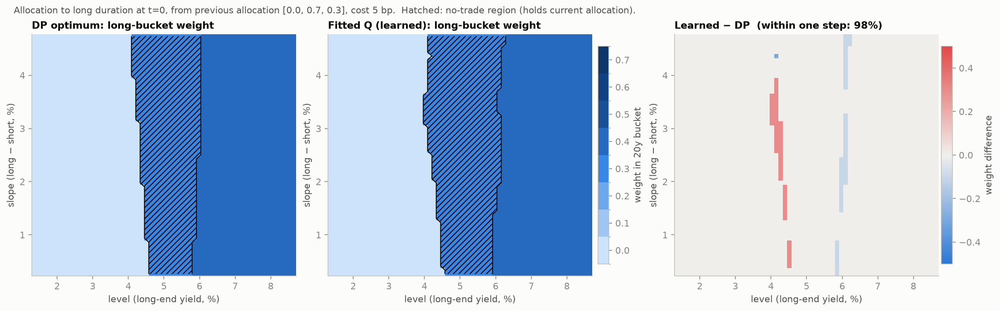
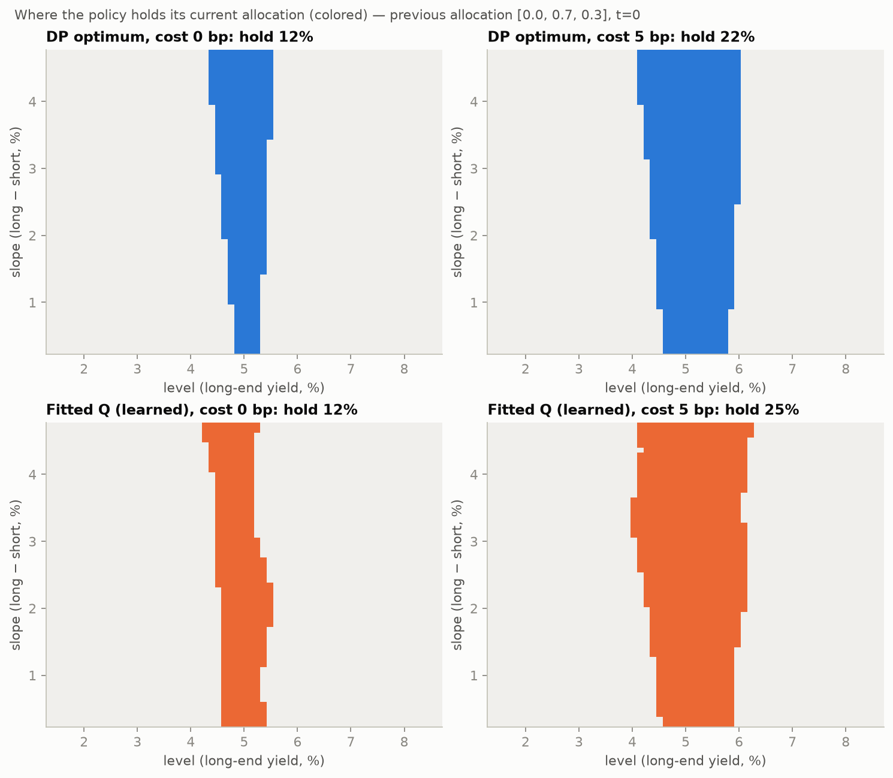
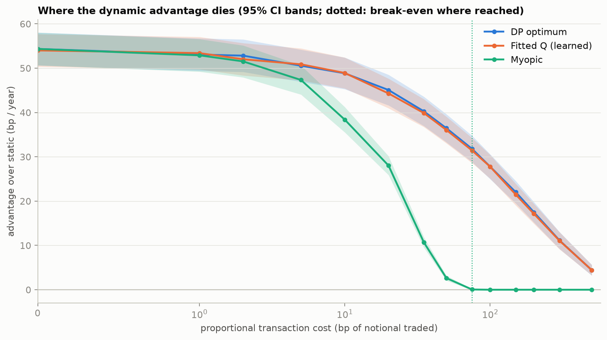
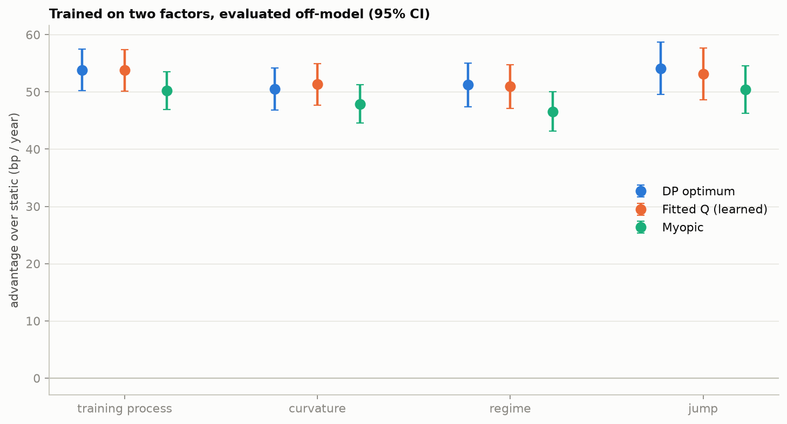
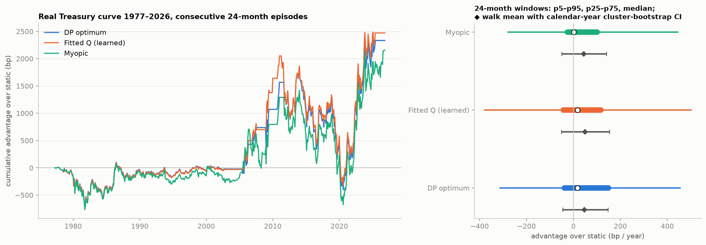

# RL for duration-aware bond allocation, verified against a computable optimum

An agent shifts a Treasury portfolio between short (2y), intermediate (7y) and long (20y)
duration buckets as the yield curve moves, under a position limit, a turnover limit, a duration
band and transaction costs.

**The deliverable is not a better allocation.** It is a learned policy *proven* correct against
an exact dynamic-programming optimum, followed by a measurement of how that correctness holds
up when the curve stops behaving like the model it was trained on.

### Why it is built this way

Reinforcement learning for portfolio allocation is a crowded category with a bad reputation,
and the reputation is earned. The historical record is too short to train on, so most results
are memorisation reported as skill. This project takes the opposite route. The world is
simulated and deliberately simple enough that the optimal policy can be computed exactly, so
the learned policy can be **verified rather than believed**. Only then is it taken somewhere
the optimum is unknown. At that point the question is not whether it wins, but how quickly
being correct stops meaning anything.

**It never trains on historical curves.** Forty years of monthly rebalancing is about 500
decisions, dominated by a handful of regimes, and overlapping windows count the same episode
many times. A policy trained on that memorises 1994, 2008 and 2022 instead of learning a rule.
Here, historical data is sealed in code until every simulation gate passes (Gate E), and it is
used only for evaluation and calibration diagnostics.

Every number below was produced by `duralloc baseline / train / policymap / evaluate` with seed
`20261014` on 2026-10-14, and is read from [`results/metrics.json`](results/metrics.json).
Gate criteria were written in [`GATES.md`](GATES.md) before anything ran.

---

## 1. The learned policy matches the DP optimum



*Weight in the 20-year bucket chosen at t = 0 from the static allocation, over the
(level, slope) plane, at 5 bp cost. Hatched: the no-trade region.*

The two policies draw the same map. Below a long-end level of about 4.2% both cut the long
bucket to zero; above about 6% both move to 0.4 (the turnover limit caps a single move). In
between, both hold. They disagree only along the edges of the no-trade region, where neither
choice is worth much.

| Gate D (5 bp cost, 50,000 common paths) | Result | Pre-stated threshold |
|---|---|---|
| DP − learned value | **−0.09 bp/yr**, 95% CI upper bound 0.42 | ≤ 2.51 bp/yr (5% of DP's advantage) |
| Long weight within one grid step of DP (t = 0 and t = 12, every in-band start, ±2σ grid) | **98.4%** | ≥ 90% |
| Exact same allocation | 92.4% | (recorded) |

On a separate set of 50,000 evaluation paths, the learned policy and DP both beat the static
allocation by **49.9 bp/yr**. Their paired difference is **0.00 bp/yr (95% CI −0.51 to
+0.51)**.

In-model value, 24-month episodes, bp per year, 95% CI:

| Policy | Value | vs static | Carry | Duration P&L | Cost | Turnover / yr |
|---|---|---|---|---|---|---|
| Static (best stationary, 0/70/30) | 458.2 | — | 458.2 | +0.1 | 0.0 | 0.00 |
| Immunize (duration 8 ± 0.5) | 428.3 | −30.0 [−31.6, −28.3] | 429.7 | +0.0 | 1.5 | 0.15 |
| Myopic (true model, one period) | 505.3 | +47.1 | 440.2 | +66.5 | 1.4 | 0.14 |
| **DP optimum** | **508.1** | **+49.9** | 434.9 | +75.7 | 2.5 | 0.25 |
| **Fitted Q (learned)** | **508.1** | **+49.9** | 435.1 | +75.3 | 2.3 | 0.23 |

The decomposition shows where the value comes from. The dynamic policies *give up* about
23 bp/yr of carry to time duration, and earn about 75 bp/yr from it.

The static baseline is the compliant allocation with the highest stationary expected return,
the strongest do-nothing policy available. That makes every "advantage over static" in this
README a conservative figure.

## 2. A no-trade band emerges under costs, and the learned one matches DP's



Across every in-band starting allocation and the ±2σ state grid, DP holds in **2.9%** of states
at zero cost and **5.3%** at 5 bp. The learned policy holds in **2.9%** and **6.3%**. The
overlap of the two hold regions (Jaccard) is **0.84** at zero cost and **0.81** at 5 bp.

Across the full cost sweep, both hold regions grow in step: DP 0.03 → 0.69 and learned
0.03 → 0.71 from 0 to 500 bp.

## 3. Where the advantage dies



At every cost level, DP is re-solved and the agent is retrained from scratch. Everything is
evaluated on 20,000 common paths.

| Cost (bp per unit traded) | 0 | 5 | 20 | 50 | 100 | 200 | 500 |
|---|---|---|---|---|---|---|---|
| DP advantage (bp/yr) | 54.4 | 50.6 | 45.1 | 36.5 | 27.8 | 17.5 | 4.4 |
| Learned advantage | 54.0 | 50.9 | 44.3 | 36.1 | 27.8 | 17.1 | 4.4 |
| Myopic advantage | 54.3 | 47.3 | 28.0 | 2.6 | 0.0 | 0.0 | 0.0 |

The **myopic** policy's advantage reaches zero at **75 bp** under the pre-stated rule (the 95%
CI lower bound falls to ≤ 0). Beyond that it never trades.

The **dynamic** policies, DP and learned, never reach break-even inside the swept range. Their
advantage decays smoothly but is still significantly positive at 500 bp (DP CI lower bound
3.2 bp/yr). The reason is visible in turnover. As costs rise the optimum trades less, not
worse (0.63 → 0.01 portfolio turnovers per year), so it can always fall back on holding. The
learned policy tracks DP at every level; the largest paired gap anywhere in the sweep is
0.8 bp/yr.

**The practitioner's number is the gap between dynamic and greedy.** At realistic Treasury
costs (≤ 5 bp) planning ahead is worth about 3 bp/yr over a greedy optimiser that already has
the true model. At 20 bp it is worth 17 bp/yr, and at 50 bp, 34 bp/yr. Almost all of the
in-model value at low cost comes from being *optimised*, and being *dynamic* only starts to
matter once costs bite.

## 4. Off-model degradation



Trained on two factors, evaluated on 20,000 paths of each stress world. Policies keep seeing
only the two-factor projection of the curve.

| World | DP advantage | Learned advantage | Learned − DP | Share of in-model advantage kept (DP / learned) |
|---|---|---|---|---|
| Training process | 53.8 [50.2, 57.4] | 53.8 [50.1, 57.4] | −0.06 [−0.86, 0.75] | 1.00 / 1.00 |
| + curvature factor | 50.5 [46.9, 54.2] | 51.3 [47.7, 55.0] | +0.83 [0.00, 1.65] | 0.94 / 0.95 |
| Regime-switching vol | 51.2 [47.4, 55.0] | 50.9 [47.2, 54.7] | −0.30 [−1.12, 0.53] | 0.95 / 0.95 |
| Level jumps | 54.1 [49.6, 58.7] | 53.1 [48.6, 57.7] | −0.99 [−1.98, 0.00] | 1.01 / 0.99 |

**Finding:** the learned policy degrades the same amount as DP in every stress world. That
means it did not overfit the generator beyond what the optimum itself is fitted to. The flip
side is that these stresses are mild. Each keeps the level factor's mean reversion intact, and
that mean reversion is what both policies trade on, so each retains ≥ 94% of its advantage.
They do not test the assumption the policy actually relies on. History does (section 5).

## 5. Real Treasury curves, 1977–2026



Gate E opened on 2026-10-14, after A–D passed, and FRED constant-maturity yields
(DGS2/5/7/10/20/30) were downloaded for the first time. Policies trained only on simulated
curves observe the two-factor projection of the real curve each month.

| Walk through 597 months (consecutive 24-month episodes) | Advantage over static, bp/yr | 95% CI (calendar-year cluster bootstrap, 50 years) |
|---|---|---|
| DP | +47.0 | [−45.6, +147.5] |
| Learned | +49.8 | [−50.4, +154.2] |
| Myopic | +43.4 | [−48.6, +141.2] |
| Immunize | −38.6 | [−140.8, +62.4] |
| Learned − DP | +2.8 | [−25.3, +28.8] |

Across all 573 overlapping 24-month windows, DP beat static in 62% and the learned policy in
60%. The median window advantage is +17 bp/yr for both, and the 5th–95th percentile range is
about −310 to +450 (DP) and −380 to +500 (learned).

**Read this as "no detectable edge", not as a win.** Every interval spans zero, and the
point estimates come from a few episodes. By decade, DP's advantage is −59 bp/yr (1977–79),
+14 (1980s), −3 (1990s), +113 (2000s), −57 (2010s) and +268 (2020s). The 2020s figure is both policies
holding zero in the 20y bucket from mid-2020 through 2022 (the long-end level sat 2–3 points
below its assumed mean), against static's 30%, when the 2022 sell-off arrived. That is one regime, and it is
the regime this kind of backtest usually ends up selecting.

**How far off-model history is:**
- 28% of months fall outside the DP state grid (±3σ) and 20% outside the agent's training box
  (±3.5σ). These are mostly the high-rate late 1970s and early 1980s, and the post-2008
  low-rate years. There, DP clamps to its grid edge and the learned policy extrapolates its
  linear features, which is where their historical paths diverge (2000s: DP +113, learned
  +171; 2010s: DP −57, learned −106).
- Fitting the same two-factor model to history (diagnostic only, never used to retrain) gives
  level mean reversion κ = 0.067/yr against the prior's 0.15. That is a half-life of about
  10 years against 4.6. Slope volatility is 2.0% against 1.0%, and shock correlation is −0.07
  against −0.30. The policy's edge is a bet on level mean reversion, and history reverts about
  half as fast as the training world assumes.

---

## The gates

Stated in [`GATES.md`](GATES.md) before any run; machine record in `results/gates.json`.

| Gate | What it checks | Result |
|---|---|---|
| A | Simulated curves reproduce target moments | PASS: worst errors are mean 1.8 bp, σ 0.1%, κ 0.8%, ρ 0.001 |
| B | First-order return vs exact pricer, ≤ 5 bp for moves ≤ 10 bp | PASS: but it breaks at a 16 bp move for the 20y bucket, which is **59% of simulated monthly moves** |
| C | Zero cost, one period: agent equals myopic optimiser | PASS: 93.9% identical (≥ 90%), mean regret 0.026 bp (≤ 0.5) |
| D | Agreement with DP under costs | PASS: see section 1 |
| E | No historical data before A–D pass | PASS: enforced in `data/fred.py`, tested |

## How it works

**Curve.** Level and slope follow Ornstein-Uhlenbeck processes, sampled with the exact
discretisation, and map to yields as `y(τ) = L − S·h(τ)` with a Nelson-Siegel loading `h`. The
parameters are round-number priors fixed before any data was seen.

**Returns.** Buckets are constant-maturity zero-coupon exposures, so modified duration equals
maturity. Monthly return is `r ≈ y·Δt − D·Δy`.

**State and actions.**
- Target weights on a 0.1-step simplex with max weight 0.7: 48 allocations.
- The 4–12 year duration band and the 0.3 one-way turnover limit form a feasibility mask that
  depends on the current portfolio.
- Reward is return minus 5 bp per unit traded, minus a duration-band penalty.

**DP** (`baselines/dp.py`). Backward induction over 24 monthly stages. The state is (previous
allocation × 31×31 level/slope grid), 46,128 states in all. The transition operator uses
7×7 Gauss-Hermite quadrature of the exact OU shock with bilinear redistribution. It solves in
0.2 s. Refining to a 51×51 grid with 9×9 nodes changes the policy value by **0.09 bp/yr**,
so the coarse optimum is converged.

**Agent** (`agent/fitted_q.py`). Finite-horizon fitted Q-iteration.
- It learns from sampled transitions only: observed curve, realised bucket returns, next
  observed curve. It never sees the OU parameters, the loadings or the return formula.
- Features: 81 normalised (partition-of-unity) Gaussian RBFs plus linear terms, ridge
  regression, 600k fresh transitions per stage.
- It relies on two facts that are exact here and stated openly:
  - `Q(w, f, a) = −cost(w, a) + G(f, a)`, so only `G` needs to be learned;
  - the market does not react to the portfolio and every bucket's return is observed, so each
    transition supplies targets for every allocation ("all-action" updates). Those targets
    share their market noise, which is what makes the argmax stable.

**Baselines.** Static (best stationary allocation), immunize (match duration 8, then
maximise carry), myopic (true-model one-period optimiser), and DP.

## Reproduce

```bash
uv venv .venv && uv pip install -e ".[dev]"
.venv/bin/duralloc baseline     # Gates A, B; static / immunize / myopic / DP       (~10 s)
.venv/bin/duralloc train        # Gate C; fitted Q at 5 bp and 0 bp; Gate D          (~6 min)
.venv/bin/duralloc policymap    # headline figure + no-trade regions
.venv/bin/duralloc evaluate     # in-model, cost sweep, off-model, historical (E)   (~40 min)
.venv/bin/pytest                # 38 tests, incl. reduced-size runs of every gate
```

Everything is config-driven (`configs/config.yaml`) and seeded. Every figure is drawn from
`results/metrics.json` (`duralloc figures`).

## Limitations

- **No convexity.** The return model drops `+½·C·Δy²`. Gate B measures the cost of that: the
  20y bucket's first-order return misses the exact pricer by more than 5 bp on 59% of
  simulated monthly moves, and the omission understates long-bucket returns in exactly the
  large-move regime the stress tests target.
- **Discretisation.**
  - Weights move on a 0.1 grid.
  - DP lives on a 31×31 factor grid and clamps outside ±3σ, which covered only 72% of
    historical months.
  - Weights do not drift between rebalances: the state is the previous target.
- **Risk-neutral objective.** The reward is expected return, so the policies are bang-bang
  across the duration band. A risk-averse objective would give interior allocations and a
  different no-trade geometry.
- **Gaussian two-factor world.** Yields can go negative, volatility is constant in training,
  and there is no roll-down. Rates are mean-reverting by assumption, and the policy's entire
  edge rests on that assumption. History reverts about half as fast as the prior.
- **Mild stress tests.** The three stress worlds leave level mean reversion intact, which is
  why both policies keep ≥ 94% of their edge. A stress that slows mean reversion or shifts its
  target is the obvious next experiment.
- **Historical evaluation is weak evidence by construction.** There are 50 calendar-year
  clusters, one regime dominates, every CI spans zero, and the final month (October 2026) is
  partial.
- **PPO not built.** It was cut per the scope plan. Fitted Q already matches DP, so a second
  method would test the method rather than the claim.
